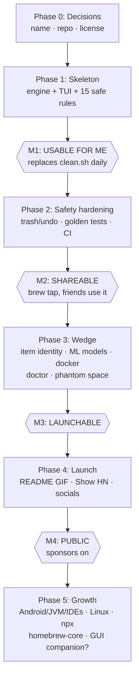

# Zero → Hero Plan

Each phase = one or a few Claude sessions with a ready prompt. Milestones (M1–M4) mark when the thing becomes *usable*, *shareable*, *launchable*, *fundable*.

## Status

<!-- Living tracker. Every session that finishes a prompt ticks its box and moves the "Now" line. Enforced via CLAUDE.md session rules. -->

- [x] P0-A name → **regrow** (2026-07-13)
- [x] P0-B scaffold — repo pushed, CI green (2026-07-13, github.com/lbagic/regrow)
- [x] P1-C engine + schema (2026-07-13)
- [x] P1-D TUI (2026-07-13)
- [x] P1-E port clean.sh + Tier-S rules → **M1 usable** (2026-07-13, 30 rules, real scan found 158.8 GiB)
- [x] Architecture review + Prompt-F groundwork (2026-07-13): trash seam, per-rule golden fixtures, scan cancellation — [review doc](plans/2026-07-13-architecture-review.md)
- [x] P2-F safety hardening (2026-07-13): clean/undo/history, trash+staging+receipts, oplog, placeholder validation, --beta-rules, GoReleaser+release CI — code done; **M2 needs manual publish** (tap repo, TAP_GITHUB_TOKEN secret, tag v0.1.0)
- [x] P3-G0 item identity (2026-07-13): `ruleID/key` ids, per-item plan/clean selectors + `Plan.Unmatched` typo guard, TUI expandable item rows (all/partial/none), `--json` keys, refits: sim devices/runtimes, xcode-archives (per-archive glob), tm-snapshots (per-snapshot delete) — [design doc](plans/2026-07-13-item-identity.md)
- [ ] **M2 publish (manual, deferred — no code coupling, do before sharing):** decide/confirm name (P0-A revisit), create `lbagic/homebrew-tap`, add `TAP_GITHUB_TOKEN` secret, `git tag v0.1.0 && git push --tags`, buy regrow.sh
- [x] P3-G ML models module (2026-07-13): 12 `ai` rules (HF hub/datasets/xet, ollama, LM Studio, torch/whisper/llama.cpp/keras/gpt4all/wandb, SD libraries surface-only), hf + ollama walkers with dedup-aware sizes + last-used, all beta — [design doc](plans/2026-07-13-ml-module.md)
- [x] P3-G2 docker detection + targeting (2026-07-13): `internal/docker` provider (one snapshot/scan, recorded-JSON tests), volume last-used join + usage ledger, 6 tiered beta rules (kept tier surface-only with reasons; volume rm exports a tarball to staging first via the new `pre_action` seam, 10 GiB cap), config file with docker keep-list; retired aggregate docker-prune/docker-volumes — verified live: the 3 dune timescale volumes land in caution-named
- [x] P3-H doctor + phantom space (2026-07-13): `regrow doctor` (hero-bug `doctor:` rule metadata + phantom-space category), new rules claude-code-cache / playwright-cache / apfs-purgeable (JXA Finder-vs-df probe), tm-snapshots + docker-vm-disk moved to phantom-space, docker-vm-disk real-vs-sparse label; docker rules graduated from beta — [design doc](plans/2026-07-13-doctor-phantom.md). **M3 check, honest status:** this machine is healthy — no hero flag fired (flagged rendering verified via lowered threshold); phantom section explains 60.8 GiB (25.3 purgeable + 35.5 real of 1 TiB sparse Docker VM). "Dramatic on ≥1 real machine" still wants a machine with a live runaway.
- [ ] P4-I launch kit → **M4 public**
- [x] PR 1 planner safety (2026-10-04, [attack plan](plans/2026-10-04-attack-plan.md)): `empties_trash` runs Empty Trash first (B5), containment forest in `BuildPlan` (nested selections planned once, surface-only never deleted inside a selection, union total), `engine.DefaultSelection` shared by `plan`, `clean` and the TUI with an empty selection planning nothing, FreesNow / AfterTrash subtotals and per-action undo on every plan surface, `regrow help` (B8)
- [x] PR 2 scan correctness (2026-10-04, [attack plan](plans/2026-10-04-attack-plan.md)): every filesystem call of a scan is bounded, so a folder that never answers costs one stall window instead of the scan, and tool queries give up after 2 min (B1); `Usage` / `Item.Partial` show a refused or blocked target as "unreadable" or "≥ X" instead of `0 B` or a rule error (B3); last-used is the newest mtime over files and directories (B4); `engine.Account` counts every byte once into four buckets (frees now, after Trash, shown only, macOS-managed) in scan text, the TUI and `--json` (B2); doctor verdicts are flagged / normal / unknown; `node-modules-dirs` reaches depth 10 (B6); the docker build-cache rule leaves out records shared with image layers (B7); `ScanStream` hands findings out as rules finish
- [x] PR 3 engine protocol (2026-10-04, [attack plan](plans/2026-10-04-attack-plan.md)): `regrow engine` speaks JSON lines over stdio ([ENGINE.md](ENGINE.md)) — hello with the Full Disk Access probe; scans streamed rule by rule after a `headroom` sample, with the ledger's summary; plan (no sudo, no unmatched selectors), execute, cancel and `tick` (the autopilot's, autotrim gate included); one scan, execute or tick in flight; single-use plan ids that expire after 10 min of wall time and die when a newer scan or an execute of their scan starts; stop after the current action on EOF; the 1 MiB line limit; steward commands on `/dev/null` stdin with captured output; one writer goroutine. `regrow scan --json` prints the same scan events; the default selection leaves out unreadable items
- [x] PR 4 headroom + go-build prune (2026-10-04, [attack plan](plans/2026-10-04-attack-plan.md)): `internal/headroom` (free/purgeable/swap samples in `headroom.jsonl`, days-to-full forecast, crossing alerts with hysteresis, acute alerts naming the top process), the `prune:` rule block and `engine.PrunePlan` run as an ordinary plan action, `regrow tick [--autotrim]`, `regrow prune go-build [--yes]`, flock single flight, build deferral, autotrim gated on a completed manual prune in the oplog; invariants 1, 2 and 4 amended. Owner checkpoint pending: first `regrow prune go-build --yes`. The engine's `tick` request landed with PR 3
- [x] PR 4 follow-up, prune hardening (2026-10-04): the prune survives a concurrent `go clean -cache` (`-ignore_readdir_race`), refuses a GOCACHE off the sampled volume, autotrims without its history against the 50 GiB band, fails a tick on an unreadable oplog only when it would prune, and the purgeable and `ps` probes have a `WaitDelay`
- [x] PR 5 menubar shell (2026-10-10, [attack plan](plans/2026-10-04-attack-plan.md)): `Regrow.app` ([APP.md](APP.md)), a SwiftPM package built with the Command Line Tools alone. Menu bar figures from a tick at launch, every 15 min and on wake, alerts as notifications, the autotrim switch; a scan window (one HTML page per [DESIGN.md](../DESIGN.md), in a web view that can load that file and go nowhere else) that scans, picks, plans and executes behind a two-screen confirm; one engine started with the login shell's environment, the app its only writer; `scripts/signing-cert.sh`, `just app` (bundle exchanged in one step, login item), `just app-smoke`. Engine: `bucket`, `select`, `expires_at`, `no_forecast`, `staged_bytes`, the missing-program skip, the sudo skip naming the engine's binary. Owner checkpoints pending: the signing identity, the first install, the smoke checks, Full Disk Access, autotrim
- [x] PR 6.1 coverage: agent sessions (2026-10-04, [attack plan](plans/2026-10-04-attack-plan.md)): catalog test (one owner per byte: no two rules share a path, compared case-folded and through `/private`, or a discover name; nested paths spell their shared prefix alike); beta rules `agent-scratch` (caution, ended sessions' scratch to the Trash) and `agent-scratch-kept` (surface-only, live sessions and sessions holding a worktree link, with the reason); live = a running process in Claude Code's session registries, a process working inside the scratch, or transcript or scratch activity within 24 h; unknown liveness offers nothing; each session is judged again right before its Trash move (`pre_action` now gates Trash moves too)
- [x] PR 6.2 coverage — git worktrees (2026-10-04, [attack plan](plans/2026-10-04-attack-plan.md)): the beta `git-worktrees` rule offers a linked worktree, one item per worktree keyed by its path, when it is merged (by ancestry, or its upstream is gone), `git status --ignored` shows nothing but whole ignored build directories and hides no tracked file, and nothing in it changed for 7 days; `git -C {path} worktree remove {path}` keeps the branch, after a `worktree-recheck` pre-action reruns the clean test; per-item native commands now pass the path guard; every plan line names the unselected items an action deletes with its target
- [x] PR 6.8 coverage: fix-the-cause rows (2026-10-04, [attack plan](plans/2026-10-04-attack-plan.md)): `regrow doctor` gains a FIX THE CAUSE section, read-only like the rest of it. A rule declares `causes:` (a named scanner check, the story, the owner's fix lines) and doctor prints whether each is in effect: aerial videos present or still downloading (the Wallpaper pane triggers the download, not a shuffle setting; macOS 15 only), three or more worktrees of one Go module while `GOFLAGS` lacks `-trimpath`, a Docker Desktop VM with no memory limit or one at half the Mac's memory or more, build-cache garbage collection switched off. Checks read settings files, listings and `go env`; no Full Disk Access, no Docker daemon. Phase 0 line 3 and item 8 of the attack plan corrected to the observed aerial behaviour
- [x] PR 6.1 follow-up, agent-session liveness (2026-10-10): the home default registry is always read; a registry file must name its process (pid and start time, which Claude Code records in UTC); an unregistered `claude` process is tolerated only below a registered session, and the keep window then reaches back to its start; transcripts are read under every knowable config folder and across the projects holding a session's scratch; a failed stat, listing or parse keeps the session or offers nothing
- [x] PR 6.4 coverage: Docker unused images (2026-10-10, [attack plan](plans/2026-10-04-attack-plan.md)): beta rule `docker-images-unused` (caution): tagged images no container runs or mounts, stopped containers included, whose repository is one Docker records them as pulled from or pushed to, last pulled or tagged 30+ days ago, each removed by `docker image rm <id>`, never forced, sized at Docker's unique size; images Docker records as built here, images retagged into another repository and images the keep-list names stay out; in the containerd image store `docker-images-dangling` no longer takes an image pulled by digest. Owner checkpoint pending: first `regrow clean --beta-rules docker-images-unused`
- [x] PR 6.3 coverage: build output (2026-10-10, [attack plan](plans/2026-10-04-attack-plan.md)): the beta `build-output` rule offers `.next`, `dist`, `.turbo` and `.venv` folders under the project roots, one item per folder keyed by its path, when an ignore rule names the folder, git tracks nothing inside it and something beside it, it holds no repository of its own, and its project is idle (no file under the project folder changed for 30 days, HEAD did not move, no running process works in it; a submodule is judged with its superproject); caution, to the Trash after a `build-output-recheck` pre-action reruns the judgement; a git failure keeps that repository's folders, an unknown process list keeps everything, and nothing is offered under a project root reached through a symlink; build output inside a finished worktree is a nested item, named on the worktree's "also removes" line. Owner checkpoint: the first real `regrow clean --beta-rules build-output/<path>`
- [x] history size fix (2026-10-11): `regrow history` prints what a run's finished actions cleaned (a done line in the journal; a prune by what it deleted), labelled "cleaned" with a note under the list; a failed or cut-short action counts nothing
- [x] PR 6.7 coverage: small fry (2026-10-11, [attack plan](plans/2026-10-04-attack-plan.md)): `npm-cache` measures `~/.npm/_cacache`, all `npm cache clean --force` deletes; beta rules `npx-cache` (safe: each `~/.npm/_npx` folder to the Trash, kept while a running process works in it or names it or for 7 days after npx ran it, after an `npx-recheck`), `downloaded-installers` (caution: a `.dmg`, `.pkg` or `.zip` in `~/Downloads` whose app is installed, a zip by the app inside it, the others by name; kept when newer than the installed app by version (inside a zip, or in a file name; a version that cannot be compared keeps it) or, for a disk image or package, by the bundle's date added, touched in the last 14 days, or unreadable; to the Trash after a `downloaded-installer-recheck`), and two surface-only rows with their fix, `macos-update-download` (an update Software Update downloaded and never installed, SIP-guarded) and `chrome-ai-model` (Chrome's on-device model). Owner checkpoints: the first real `regrow clean --beta-rules npx-cache` and `regrow clean --beta-rules downloaded-installers`
- [x] volume exports in the clean summary (2026-10-11): a removed docker volume is counted under "Volume exports" with the staging folder to delete and the note that `regrow undo` does not restore it, not under "Freed now"; the app's result screen and the engine's `result.exported_bytes` follow
- [x] aerial wallpapers surface-only (2026-10-11): `aerial-wallpapers` no longer deletes the videos with `sudo find … -delete` and is out of the default selection; its row and `regrow doctor`'s fix line give the command to run yourself
- [x] PR 6.5 coverage: toolchains (2026-10-11, [attack plan](plans/2026-10-04-attack-plan.md)): beta `fnm-node-versions` (caution, `fnm uninstall <version>` after an `fnm-version-recheck` pre-action) offers each fnm Node version no alias, `.nvmrc`/`.node-version` (home and the project roots), launchd plist (the three launchd folders, XML or binary; a path into it, or fnm run with it) or running process (lsof `txt`) names, and offers nothing when any source is unknown or under `sudo`; nvm left out. Beta `android-ndk` and `android-sdk` (caution, to the Trash) offer `~/Library/Android/sdk`'s NDKs and the SDK while no Android Studio is installed (Applications folders and one below, Toolbox's store, Spotlight), NDKs nested in the SDK row. Beta `sim-runtimes-no-xcode` (surface-only) shows runtimes left after Xcode through CoreSimulator's own simctl, only while `xcrun` finds no simctl and no Xcode app is installed. Owner checkpoint: the first real `regrow clean --beta-rules fnm-node-versions`, `regrow clean --beta-rules android-ndk` and `regrow clean --beta-rules android-sdk`
- [x] volume exports bucket (2026-10-11): `engine.Totals` gains `exported`, so a docker volume removed after its export is in a total of its own, not in "frees now", in `regrow scan`, the plan lines, the TUI and the app's scan, plan and confirm screens (a fifth total when the scan holds a volume; the meter's "free once the commands end" leaves it out); the protocol adds `exported` to `totals` and `bucket` at version 1
- [x] undo counts what is on disk (2026-10-11): `regrow history`'s "restorable" and a bare `regrow undo`'s pick count only moves whose Trash or staging copy is still there; a run with nothing left says why, and `regrow undo <run-id>` refuses it
- [x] reclaim figure without volume exports (2026-10-12): the plan's "Would reclaim" (`regrow plan`, the TUI plan screen, and `regrow clean`'s list, once "Total:") adds up "Frees now" and "Frees after Trash" through `Plan.ReclaimBytes`, so a docker volume's export, whose tarball keeps its bytes on disk, is on its own "Volume exports" line only

**Now:** personal-first reset — [attack plan](plans/2026-10-04-attack-plan.md): PR 1 planner safety, PR 2 scan correctness, PR 3 `regrow engine` protocol and PR 4 headroom + go-build prune done (owner runs the first `regrow prune go-build --yes`), PR 5 menubar shell done (owner checkpoints in [APP.md](APP.md): signing identity, `just app`, the smoke checks, Full Disk Access, autotrim) → PR 6+ coverage (6.1 agent sessions with its liveness follow-up, 6.2 git worktrees, 6.3 build output, 6.4 Docker unused images, 6.5 toolchains, 6.7 small fry and 6.8 fix-the-cause rows done; the owner applies the fixes `regrow doctor` prints and runs the first `regrow clean --beta-rules docker-images-unused`, the first `regrow clean --beta-rules build-output/<path>`, the first `regrow clean --beta-rules npx-cache` and `regrow clean --beta-rules downloaded-installers`, and the first `regrow clean --beta-rules` of `fnm-node-versions`, `android-ndk` and `android-sdk`). `regrow history` sizes count finished actions only, and a docker volume is counted in its export, not as freed (the run summary, and the scan's and plan's totals); `aerial-wallpapers` is surface-only; undo counts only what is still on disk; "Would reclaim", on `regrow plan`, the TUI and `regrow clean`, leaves out a docker volume's export. Launch work (Prompt I, M2 publish) parked.

---

## Phase 0 — Decisions (1 short session)

**Prompt A — name:**
> Analyze name candidates for the cleaner product (reclaim, regen, hoard, disksmith, sweeper + generate 10 more). Check collisions: brew formula, npm, crates.io, GitHub repos, domains (.dev/.sh), App Store. Criteria: verb-like, typeable, hints "everything deleted regenerates", no snake-oil vibes. Recommend top 3 with evidence.

✅ **Decided (2026-07-13): `regrow`** — tentative, revisit before M2/brew tap. Evidence: crates.io free, brew free, regrow.sh free, npm squatted but dead (8 dl/mo, last publish 2022 — disputable), no GitHub presence (top repo ★23). Runners-up: mow (domains taken), cull (no regen hint). Wildcard if regrow falls through: disksmith (100% clean everywhere, but not verb-like).

**Prompt B — scaffold decisions:**
> Init the repo: git, MIT license, Go module (name from Prompt A), directory layout for: rule engine (rules/*.yaml embedded), scanner, TUI (bubbletea), trash/undo, oplog. Write ARCHITECTURE.md stub. No features yet — structure + CI skeleton (GitHub Actions, macOS runner, lint+test).

Exit: name chosen, repo pushed, CI green on hello-world.

## Phase 1 — Skeleton → **M1: usable for me**

**Prompt C — engine + schema:**
> Implement the rule engine per docs/PRODUCT.md §6: YAML rule schema {id, title, risk, os paths (version-aware), marker discovery, native command, regen story, sudo}, loader, size scanner (du + tool queries), dry-run planner producing exact command list.

**Prompt D — TUI:**
> Bubbletea checklist TUI per PRODUCT.md §4 sketch: grouped by category, size-ranked, risk colors, note on cursor, plan screen before any action. `--json` output mode.

**Prompt E — port clean.sh:**
> Port all modules from clean.sh into YAML rules + add Tier-S from docs/research/02: DerivedData, DeviceSupport, CoreSimulator devices+runtimes (simctl only), docker prune, npm/yarn/pnpm, go, brew, pip/uv, TM snapshots, aerial (Sequoia+Tahoe paths), trash. Golden test per rule with fixture $HOME.

**M1 check:** `regrow` run on this Mac finds ≥60GB, executes via trash, undo works. clean.sh retired.

## Phase 2 — Safety hardening → **M2: shareable**

**Prompt F:**
> Harden: path guards (empty//`/`/$HOME/mounts), trash-not-rm with staging fallback, oplog jsonl + `undo` + `history`, fixture-home golden tests for every rule, race/permission edge cases (read-only go mod cache, root sim runtimes), `--beta-rules` gate. Then: GoReleaser config, brew tap repo, signed release v0.1.

Pre-done (2026-07-13, [architecture review](plans/2026-07-13-architecture-review.md)): per-rule golden coverage shipped; trash seam placed — `internal/trash` owns the mechanism (`PreviewCommand`), planner emits intent. Build Move/receipts/staging behind that seam; design their signatures with the executor, they were deliberately not stubbed. Also in scope now that commands execute: placeholder validation (review candidate 4 — a `{arg}` typo silently downgrades a per-item command; must fail at load, not execution).

**M2 check:** friend installs via `brew install you/tap/name`, runs it, nothing scary happens. Issues template up.

## Phase 3 — Wedge → **M3: launchable**

Order matters: G0 is the shared groundwork (candidate 5 in [architecture review](plans/2026-07-13-architecture-review.md)); G and G2 are its two consumers and can run in either order after it.

**Prompt G0 — item identity:**
> Lift selection from per-rule (`map[ruleID]bool`) to per-item: items get stable IDs `{ruleID, itemKey}`, TUI grows expandable per-item rows (toggle, size, last-used, risk badge, note), planner/executor accept item-scoped actions, `--json` carries items. No new data sources — prove it by refitting existing per-item rules (sim devices, xcode archives, TM snapshots) so per-rule selection remains the default UX and per-item is opt-in expansion.

**Prompt G — ML module:**
> Implement AI-model support per research/02 §9: HF hub via `hf`/scan-cache (dedup-aware sizes, last-used, delete via CLI), ollama list/rm, LM Studio dir detection, ComfyUI/SD surface-only. Show per-model rows w/ last-used (via G0 item identity).

**Prompt G2 — docker detection + targeting:**
> Build the docker provider per [docker usage timestamps](plans/2026-07-13-docker-usage-timestamps.md). Detection: daemon probe via docker context (Docker Desktop/OrbStack/colima all speak the same API); daemon down ⇒ rules don't apply, no error. Enumerate volumes/containers/images/networks/build cache with sizes from `system df -v`. Volume last-used = join container `.Mounts` × `.State.StartedAt/FinishedAt`; persist a usage ledger in the state dir keyed `name+CreatedAt`, merged on every scan, so history survives container removal. Classify per the research doc: protected (referenced by any container — never deletable) / caution-named (dangling + compose-labeled, never auto-selected, per-item confirm) / caution-anon (anonymous + dangling + older than N days) / safe (build cache via `unused-for`, stopped containers by age, dangling images). Image last-used from referencing containers + `LastTagTime` — never `image prune --filter until` (filters on build time). Keep-list (name/glob/compose-project) in config. Targeted per-item actions: `volume rm` preceded by tarball export to staging (VM data can't go to Finder trash — export preserves the trash-not-rm invariant; decide size cap in-session), container/image rm by ID, `builder prune --filter unused-for=`. Tests: recorded daemon JSON behind the client seam, golden per classification tier. Catalog: retire `docker-volumes.yaml` (aggregate prune) in favor of per-item rows; `docker-prune.yaml` narrows to safe tier; `docker-vm-disk.yaml` stays surface-only.

Live evidence for the classifier (2026-07-13, this machine): 3 dangling volumes were all *named, compose-labeled, active-project* data (`dune_timescaledb_*`) — exactly what `volume prune --all` would destroy. "Dangling ≠ safe" is the whole point of the tiering.

**Prompt H — doctor + phantom:**
> `regrow doctor`: hero-bug scanners (~/.claude/debug, mediaanalysisd, .Spotlight-V100, Playwright transform cache) + phantom-space category (TM snapshots, Docker VM real-vs-logical via the G2 provider, purgeable) with explainer copy.

**M3 check:** doctor finds something dramatic on ≥1 real machine; screenshot-worthy. Docker view shows named project volumes as protected/caution with last-used dates — nothing precious is one keystroke from deletion.

## Phase 4 — Launch → **M4: public**

**Prompt I:**
> Launch kit: README hero (GIF of scan finding X GB, wedge categories first), trust section (dry-run/trash/undo/open rules/test strategy), curl|sh installer, Show HN draft (neutral 8–12 word title) + FAQ answers, r/macos + Lobsters + HelloGitHub posts. Sponsors + Ko-fi enabled.

Launch ritual (manual): Tue–Thu 9–12 ET, reply every comment first hour, follow-up release within days.

## Phase 5 — Growth (post-launch, demand-driven)

Order by issue traffic: Android/JVM rules → JetBrains/VSCode/Cursor → Rust target discovery → Linux → npx (optionalDependencies) → homebrew-core (at ~225 stars) → decide paid GUI companion ($99 Apple dev acct + notarization then).

---

## Session cadence

Each prompt ≈ one focused session. Phases 0–1 ≈ a weekend of evenings. Keep every session ending with: tests green, CHANGELOG line, one dogfood run on the real machine, Status block above ticked.
